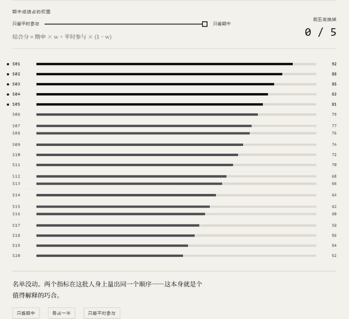

  <picture>
    <source media="(prefers-color-scheme: dark)" srcset="https://raw.githubusercontent.com/peishenglai3-hash/peishenglai3-hash/main/assets/hero-dark.svg">
    
  </picture>

2026 · 主页号　·　[10 秒 → 我在做什么](#10-秒)　·　[1 分钟 → 能做什么](#能做什么)　·　[3 分钟 → 项目](#项目)　·　[动手 → 展厅](https://peishenglai3-hash.github.io/)

## 10 秒

我是赖培胜，也写作赖子清，本科在华中科技大学读社会学。问题意识来自历史唯物主义，研究入口是**工程现场和评价装置**：智能和人的判断怎样在具体制度里被生产、评价、承认，又怎样被重新打开。

这两年我在两件事之间来回走：一件是把真实的社会材料、研究问题做成能跑、能测、能回滚的系统；另一件是追问这些系统凭什么算「完成」。

现在在做：完成资格论文、教育社会学札记与视频、Open Possibility Lab、DSH Research Mode。

 

## 能做什么

每一格都挂了指得进去的东西。挂不上的不放。

| 能力 | 我能到什么程度 | 证据 |
|---|---|---|
| 研究设计 | 把模糊的问题拆成可观测、可反驳的结构，并预先写清它证明不了什么 | [Open Possibility Lab](https://github.com/peishenglai3-hash/open-possibility-lab) |
| 系统架构 | 把流程做成可回放的一等对象：原始事件、可重建状态、残差与反思 | [Praxis Runtime](https://github.com/peishenglai3-hash/praxis-runtime) · [TFRK](https://github.com/peishenglai3-hash/the_final-runtime-kernel) |
| 前后端 | 一个人从数据层做到能玩的界面，含桌面打包 | [《红色源代码：洪湖篇》](https://github.com/peishenglai3-hash/honghu_game) · [学工 AI 助手](https://github.com/peishenglai3-hash/student-affair-AI-assistant) |
| 数据与测量 | 写量表、跑统计、把口径写进文档；知道一份问卷哪一步会失真 | [ALIS 量表](https://github.com/peishenglai3-hash/alis-ai-literacy-survey) · [cohortlens](https://github.com/peishenglai3-hash/cohortlens) |
| 发布与运维 | 打 tag、发 Release、写变更说明；别人拿得到、跑得起来 | [DSH Research Mode Releases](https://github.com/peishenglai3-hash/dsh-research-mode/releases) |
| 写作与表达 | 用第一人称写机制，不用形容词代替论证 | 本页 [#边界](#边界) · [Mohen-read](https://github.com/peishenglai3-hash/Mohen-read) |

### 技术栈

按「能交付到什么程度」分档，不按 logo 墙分。

- **能独立从零交付**：Python（3.12 / 类型标注 / 打包发版）、TypeScript 与 Node、Vue 3、Phaser 3、Streamlit、HTML/CSS/SVG（含手写动画）、JSONL 与 SQLite 做证据存储。
- **能读能改**：React、Electron 桌面打包、Go（在 WeKnora 的 fork 上改过接口）。
- **读过、不动手**：PyTorch 与最小模型训练（读过 minimind、LLMs-from-scratch 的实现，没自己训过能拿出手的东西）。

## 项目

四条线。每条线先说它在解决什么问题，再说它现在到哪一步——以及它**不声称**什么。

### 一 · 研究基础设施　`让"做过什么"变成能被别人复算的东西`

**[Open Possibility Lab](https://github.com/peishenglai3-hash/open-possibility-lab)**
 研究协作的条件：来源不可静默改写，分歧不被平均，闭合可以重开，人可以带走自己的部分。
 **〔研究原型〕** Python 3.12 / Streamlit / MIT　不声称可用性、用户收益或生产就绪；目前只有合成证据与 E1 结构证据。

**[DSH Research Mode](https://github.com/peishenglai3-hash/dsh-research-mode)**
 DeepSeek Harness 的科研工作流：把产物和证据链做成一等对象，本地优先，承认自己证明不了什么。
 **〔工程发布〕** 版本见下方徽章 · JavaScript / MIT　不声称替代研究判断、同行评审或对真实数据的解释。

**[Praxis Runtime](https://github.com/peishenglai3-hash/praxis-runtime)**
 长期人机协作的 local-first runtime：原始事件、可重建状态、残差与反思、可争议资产。
 **〔v0.1.0-engineering-preview〕** TypeScript / SQLite　不声称生产可用，也不声称已被实证证明有用。

**[The Final Runtime Kernel](https://github.com/peishenglai3-hash/the_final-runtime-kernel)**
 把可重放的失败轨迹变成有证据边界、范围意识和可撤销性的协议；JSONL 是唯一持久事实源。
 **〔V1.0 工程切片〕** Python / JSONL / MIT · 未打 tag　不是通用 Agent 平台。

### 二 · 可玩与叙事　`把一段历史做成能走进去的场`

**[《红色源代码：洪湖篇》](https://github.com/peishenglai3-hash/honghu_game)**
 像素风叙事 RPG：从当代实践队走进 1927 年的洪湖。序章与第一至第四章已连成可玩闭环。
 **〔可玩项目〕** Phaser 3.90 / Vue 3 / TypeScript / Electron　PWA 与 Electron 集成在 `feature/pwa-resource-loading`；素材授权需逐项核对。

### 三 · 校园与社会调查　`把一份问卷做成一个能用的东西`

**[社小会 · She Xiao Hui](https://github.com/peishenglai3-hash/she-xiao-hui-open-source)**
 面向社会学学习与校园生活的数字人示例，公开版删去真实名录与凭据。

**[学工 AI 助手](https://github.com/peishenglai3-hash/student-affair-AI-assistant)**
 面向辅导员的本地优先桌面应用。

同一条线上还有 [文津 · AI 社会调查发布版](https://github.com/peishenglai3-hash/wenjin-ai-social-survey-release)、[ALIS 量表](https://github.com/peishenglai3-hash/alis-ai-literacy-survey)、[cohortlens](https://github.com/peishenglai3-hash/cohortlens)。这三个偏工具，还没到可以单独成段的地步。

### 四 · 学习与归档　`留下的东西，不删`

**[Mohen-read](https://github.com/peishenglai3-hash/Mohen-read)**
 最早的项目（2026-11 补传归档），用来记录阅读与思想成长；不完整，但我留着它。

仓库里另有若干 fork（WeKnora、semantica、minimind 等），是我读别人的代码留下的。**fork 不是我的作品**，看原创请看上面四条线。

## 动手

主页写的是结论。结论下面的东西在展厅里，三个页面，单文件、零外部请求、断网也能开。

<table>
<tr>
<td width="50%">

</td>
<td width="50%">

</td>
</tr>
<tr>
<td valign="top"><b>书桌</b> 四个可点的地方。内容全部来自那张图上真实写着的字，没补台词。 <a href="https://peishenglai3-hash.github.io/desk/">点开这张桌子 →</a></td>
<td valign="top"><b>评价装置沙盒</b> 二十个虚构学生，一个可以拖的权重。看「谁被认作有能力」有多依赖你手上那把尺子。 <a href="https://peishenglai3-hash.github.io/sandbox/">拖一下权重 →</a></td>
</tr>
</table>

## 方法

  <picture>
    <source media="(prefers-color-scheme: dark)" srcset="https://raw.githubusercontent.com/peishenglai3-hash/peishenglai3-hash/main/assets/field-dark.svg">
    
  </picture>

这张图是方法，不是成就。哪一步没有发生，结论就降级为描述或猜想。[在展厅里可以拿掉任意一步，看它降成什么 →](https://peishenglai3-hash.github.io/field/)

## 兴趣议程

三件我打算长期跟的事。写成问题，不写成主张。

- **评价装置与完成资格**：考试、评分、排名、benchmark 这些装置，怎样参与定义「什么叫能力」，又怎样决定谁被认出来。
- **数字不平等与社会原子化**：当工具足够便宜，为什么差距没有缩小；以及「连接」变多之后，人为什么更孤独。
- **教育社会学与可考的主体**：一份成绩单背后，什么样的学生被制度性地生产出来。

## 边界

<b>这一页不声称什么</b>（点一下收起）

- 这不是论文发表清单。我写的东西大多还没到可以称为「发表」的程度。
- 这不代表任何机构、导师或团队立场。
- 不把 The Final 当作所有问题的入口；它可能被现实推翻，也可能被更精确的解释替代。
- 批判一个理论之前，先读文本、核数字；「我读不懂」不等于「它不行」。
- 我不认为流畅等于理解，也不认为「像人」等于有主体性。
- 我会改、会撤回。如果这页和仓库证据冲突，以仓库为准。
- 我保留不把全部私人材料公开的权利。
- 展厅里二十个学生、两个指标、一句「综合分」都是我编的；那里想说明的是排序有立场，不是这批人有问题。

<b>小史</b>：怎么走到现在

- 2026.06 — Codex Habitat：习惯共振内核的最早原型。
- 2026.08 — 《红色源代码：洪湖篇》立项。
- 2026.09 — TFRK 与 Praxis；第一篇论文《从建议到事实》。
- 2026.10 — 《手段怎么变成了目的》《正在成为历史的智能》《思想为什么必须廉价》；完成资格论文。
- 2026.11 — 教育社会学札记与视频尝试；Open Possibility Lab；DSH Research Mode；把这一页做成两层：门厅与展厅。

更早的起点是 [Mohen-read](https://github.com/peishenglai3-hash/Mohen-read)——最早的项目，2026-11 补传归档。

<b>English</b>

I am Peisheng Lai (赖培胜), an undergraduate in sociology at Huazhong University of Science and Technology (2025 cohort). My problem awareness comes from historical materialism; my research entry is the engineering site and evaluation devices: how intelligence and human judgment are produced, evaluated, recognized and reopened inside concrete institutions.

Current work: completion qualification and action authority in generative-AI projects; education sociology and the exam-able subject; Open Possibility Lab (provenance-first research collaboration); DSH Research Mode (evidence-first research workflows for DeepSeek Harness).

Most of it is prototype work. The status line under each project says what that project does **not** claim. Interactive demos live at [peishenglai3-hash.github.io](https://peishenglai3-hash.github.io/).

Email: peishenglai3@gmail.com

## 版权页

- 刊头与方法图：歸藏设计「墨水经典」一系改造（亮色墨经典 / 暗色午夜墨），矢量手写，随系统深浅色切换。
- 中文 Noto Serif SC，英文 Source Serif 4，元信息 IBM Plex Mono。
- 工具：DeepSeek Harness、Chrome、ffmpeg。
- 本页可被修正；与仓库冲突时，以仓库为准。
- 联系：[peishenglai3@gmail.com](mailto:peishenglai3@gmail.com) · [@peishenglai3-hash](https://github.com/peishenglai3-hash)

页面状态： ·  · 
