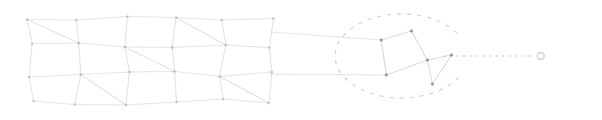
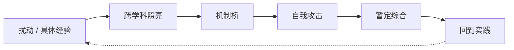

# 赖培胜· Mark Lai

AI 社会学 · 证据优先的工程 · 华中科技大学社会学院 2025 级

<picture>
  <source srcset="https://raw.githubusercontent.com/peishenglai3-hash/peishenglai3-hash/main/assets/field.svg" type="image/svg+xml">
  
</picture>

● 记录　— 来源　┄ 暂时闭合　○ 可以带走自己部分的人。这张图不是装饰，它是我多数项目共享的最小结构。

> [!NOTE]
> 如果只看一句：我在研究智能系统如何改变人做判断的条件；在工程里，我试着把「拒绝、退出、重开」做成真的能用。

[10 秒 → 现在](#现在)　·　[1 分钟 → 代表项目](#代表项目)　·　[10 分钟 → 研究循环](#研究循环) 与 [边界](#边界)

 · 

## 现在

- **在读** — 华中科技大学社会学院，社会学方向，2025 级（大二）
- **方向** — AI 社会学 · 人机知识生产 · 数字不平等与社会原子化
- **在做** — Open Possibility Lab；DSH Research Mode；《红色源代码：洪湖篇》的后续迭代
- **在学** — 把「证据边界」写成工程约束，而不是写在简介里

## 关于

我是赖培胜，也写作Mark Lai，本科在华中科技大学读社会学。我的兴趣在数字社会、人工智能社会学、STS 与 HCI 之间；也关心数字不平等、社会原子化，以及「资本主义精神」在生成式 AI 时代的变形。

我目前的训练有两头：一头是社会科学的问题与证据，一头是把问题做成能跑、能测、能回滚的系统。两边都还不成熟，所以我尽量把「已验证」「推断」「还不知道」分开写。

社会科学仍是我的研究训练。但我不想把每个技术问题都提前解释成社会理论问题：先理解机制、实现与证据，再讨论它进入现实场景后带来的机会、约束和责任。

我的工作围绕三个问题展开：

1. 如何把真实的社会材料、研究问题与可运行的数字产品连接起来；
2. 如何让 AI 参与研究和创作，同时保留人的判断、责任与退出权；
3. 如何用可追溯的事件、测试和发布边界，减少「看起来完成」与「确实被验证」之间的混淆。

## 代表项目

状态按 2026-11-06 核对[^1]；每行末尾写的是它**不**声称什么。

| 项目 | 它是什么 | 状态 / 边界 |
| --- | --- | --- |
| [Open Possibility Lab](https://github.com/peishenglai3-hash/open-possibility-lab) | 研究协作的条件：来源不可静默改写，分歧不被平均，闭合可以重开，人可以带走自己的部分。 | **研究原型** · Python 3.12 / Streamlit / MIT 不声称可用性、用户收益或生产就绪；目前只有合成证据与 E1 结构证据。 |
| [《红色源代码：洪湖篇》](https://github.com/peishenglai3-hash/honghu_game) | 像素风叙事 RPG：从当代实践队走进 1927 年的洪湖。序章与第一至第四章已连成可玩闭环。 | **可玩项目** · Phaser 3.90 / Vue 3 / TypeScript / Electron PWA 与 Electron 集成在 `feature/pwa-resource-loading`，`main` 是较早基线；素材授权需逐项核对。 |
| [DSH Research Mode](https://github.com/peishenglai3-hash/dsh-research-mode) | DeepSeek Harness 的科研工作流：把产物和证据链做成一等对象，本地优先，承认自己证明不了什么。 | **v0.1.0** · 2026-11-05 · JavaScript / MIT · npm 已发布（多包） 不声称替代研究判断、同行评审或对真实数据的解释。 |
| [Praxis Runtime](https://github.com/peishenglai3-hash/praxis-runtime) | 长期人机协作的 local-first runtime：原始事件、可重建状态、残差与反思、可争议资产。 | **v0.1.0-engineering-preview** · 2026-09-19 · TypeScript / SQLite 不声称生产可用，也不声称已被实证证明有用。 |
| [The Final Runtime Kernel](https://github.com/peishenglai3-hash/the_final-runtime-kernel) | 把可重放的失败轨迹变成有证据边界、范围意识和可撤销性的协议；JSONL 是唯一持久事实源。 | **v0.1.0（V1.0 工程切片）** · Python / JSONL / MIT · 未打 tag 不是通用 Agent 平台。 |

也在做：[社小会 · She Xiao Hui](https://github.com/peishenglai3-hash/she-xiao-hui-open-source)——面向社会学学习与校园生活的数字人示例，公开版删去真实名录与凭据；[学工 AI 助手](https://github.com/peishenglai3-hash/student-affair-AI-assistant)——面向辅导员的本地优先桌面应用。

起点：[Mohen-read](https://github.com/peishenglai3-hash/Mohen-read)，最早的项目（2026-11 补传归档），用来记录阅读与思想成长；不完整，但我留着它。

## 研究循环

这张图描述方法，不描述成就。哪一步没有发生，结论就应降级为描述或猜想。

## 理念

- 物质、社会关系与历史过程先于解释。技术既不是宿命，也不是中性工具。
- 人的主体性不是孤立内心，而是能回到现实、识别错配、拒绝、负责，再改变。
- 表征不是现实。界面、标签、记忆和「共识」都可能被组织。
- 矛盾会生产知识，也会造成伤害。不把失败浪漫化。
- 理论必须能被后来者修正，甚至推翻我。
- 功成不必在我；但功成之前，先把证据留下。

理论资源：马克思、博尔坦斯基式的批判实用主义、STS。写在这里是交代问题从哪来，不是给项目加背书。

## 边界

<b>这一页不声称什么</b>（点一下收起）

- 这不是论文发表清单。我写的东西大多还没到可以称为「发表」的程度。
- 这不是产品成熟度声明。「能跑」不等于「有用」，「有用」也不等于「对人好」。
- 我不认为流畅等于理解，也不认为「像人」等于有主体性。
- 本页不代表任何机构、导师或团队立场。
- 我会改、会撤回。如果这页和仓库证据冲突，以仓库为准。
- 我保留不把全部私人材料公开的权利。

<b>小史</b>：怎么走到现在

- 2026.05 — 第一个校园信息平台 demo，用 Manus 搭的。
- 2026.06 — Codex Habit：习惯共振内核的最早原型。
- 2026.07 — 桌面陪伴 Agent 的一次试错。
- 2026.08 — 《红色源代码：洪湖篇》立项。
- 2026.09 — TFRK 与 Praxis：把「证据」写成 runtime。
- 2026.11 — Open Possibility Lab；DSH Research Mode 发布 v0.1.0。

更早的起点是 [Mohen-read](https://github.com/peishenglai3-hash/Mohen-read)——最早的项目，2026-11 补传归档。

## 工具箱

`TypeScript` · `Python` · `Vue` · `React` · `Phaser` · `FastAPI` · `Streamlit` · `SQLite` · `JSONL` · `Git / GitHub`

最近主要在 DeepSeek Harness（DSH）上写插件和研究工作流。

## 为什么开源

我从 GitHub 和开放社区获得过许多帮助，因此也愿意把可公开的工程经验、测试方法与失败记录留给后来者。

项目不必因为尚未成熟就被包装成完成品。只要来源清楚、边界明确，别人就有机会继续修正、质疑和发展它。

功成不必在我。

## 联系

- Email: [peishenglai3@gmail.com](mailto:peishenglai3@gmail.com)
- GitHub: [@peishenglai3-hash](https://github.com/peishenglai3-hash)

欢迎交流 AI 社会学、人机协作、数字叙事与开源工程。发现事实错误，直接开 Issue 或发邮件告诉我，我会改。回复不一定及时，但会读。

<b>English</b>

I am Peisheng Lai (赖培胜), an undergraduate in sociology at Huazhong University of Science and Technology (2025 cohort). I work on the conditions under which intelligent systems change how people judge, and on keeping refusal, exit, and reopening as real options in the systems I build.

Current work: Open Possibility Lab (provenance-first research collaboration), DSH Research Mode (evidence-first research workflows for DeepSeek Harness), and a playable narrative game about local history. Most of it is prototype work; the status lines above say what each project does not claim.

Email: peishenglai3@gmail.com

[^1]: 核对日期 2026-11-06。项目状态以各仓库的 Release、README 与 npm registry 为准；如果本页与仓库冲突，以仓库为准。
