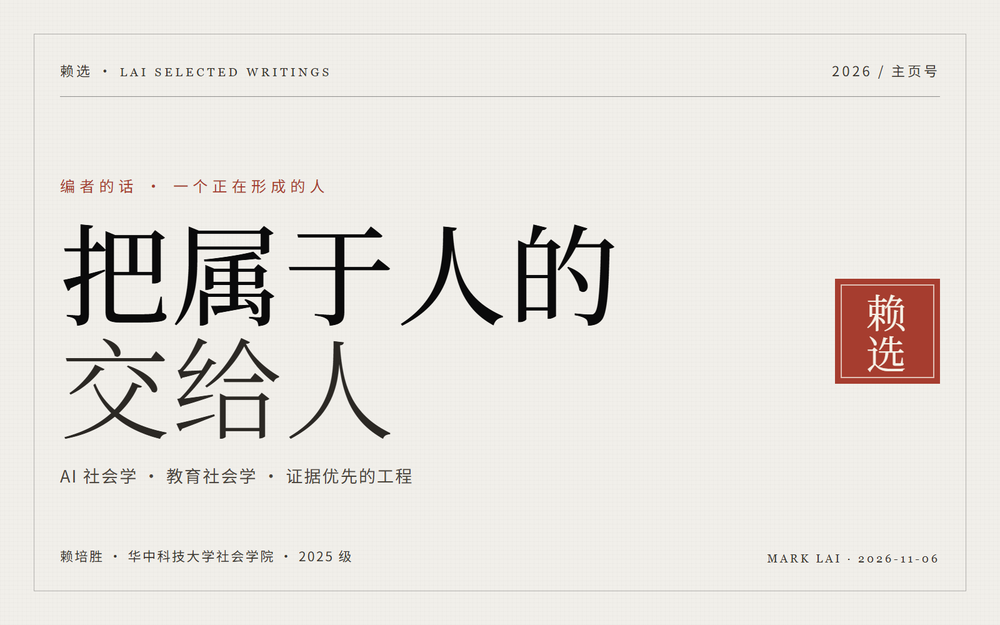

  

2026 · 主页号　·　更新 2026-11-06　·　[10 秒 → 编者的话](#编者的话)　·　[1 分钟 → 篇目](#篇目)　·　[10 分钟 → 方法](#方法) 与 [边界](#边界)

## 编者的话

我是赖培胜，也写作赖子清，本科在华中科技大学读社会学。我的问题意识来自历史唯物主义这一路，研究入口是工程现场和评价装置：智能和人的判断怎样在具体制度里被生产、评价、承认，又怎样被重新打开。

这两年我一直在两件事之间来回走：一件是把真实的社会材料、研究问题做成能跑、能测、能回滚的系统；另一件是追问这些系统凭什么算「完成」。我关心生成式 AI 项目里的完成资格、行动权限与工作重组，也关心考试、评分、排名、benchmark 这些评价装置怎样参与定义「什么叫能力」。数字不平等、社会原子化、资本主义精神危机，仍然是我看这些问题的背景。

我不太想把每一个技术问题都提前解释成社会理论问题。先理解机制、实现与证据，再讨论它进入现实场景后带来的机会、约束和责任。理论在我这里更像工具：可以用，可以改，也可以被后来的现实推翻。The Final 是某个阶段摘到的低垂果实，不是所有问题都必须经过的入口。

> 它们不必伟大，也值得存在。
>
> —— 2026.10.29

## 篇目

五件正在做的事。每一条都写它不声称什么。状态按 2026-11-06 核对[^1]。

### 01 · [Open Possibility Lab](https://github.com/peishenglai3-hash/open-possibility-lab)

研究协作的条件：来源不可静默改写，分歧不被平均，闭合可以重开，人可以带走自己的部分。

**〔研究原型〕** Python 3.12 / Streamlit / MIT
不声称可用性、用户收益或生产就绪；目前只有合成证据与 E1 结构证据。

---

### 02 · [《红色源代码：洪湖篇》](https://github.com/peishenglai3-hash/honghu_game)

像素风叙事 RPG：从当代实践队走进 1927 年的洪湖。序章与第一至第四章已连成可玩闭环。

**〔可玩项目〕** Phaser 3.90 / Vue 3 / TypeScript / Electron
PWA 与 Electron 集成在 `feature/pwa-resource-loading`，`main` 是较早基线；素材授权需逐项核对。

---

### 03 · [DSH Research Mode](https://github.com/peishenglai3-hash/dsh-research-mode)

DeepSeek Harness 的科研工作流：把产物和证据链做成一等对象，本地优先，承认自己证明不了什么。

**〔v0.1.0〕** 2026-11-05 · JavaScript / MIT · npm 已发布（多包）
不声称替代研究判断、同行评审或对真实数据的解释。

---

### 04 · [Praxis Runtime](https://github.com/peishenglai3-hash/praxis-runtime)

长期人机协作的 local-first runtime：原始事件、可重建状态、残差与反思、可争议资产。

**〔v0.1.0-engineering-preview〕** 2026-09-19 · TypeScript / SQLite
不声称生产可用，也不声称已被实证证明有用。

---

### 05 · [The Final Runtime Kernel](https://github.com/peishenglai3-hash/the_final-runtime-kernel)

把可重放的失败轨迹变成有证据边界、范围意识和可撤销性的协议；JSONL 是唯一持久事实源。

**〔v0.1.0 · V1.0 工程切片〕** Python / JSONL / MIT · 未打 tag
不是通用 Agent 平台。

也在做：[社小会 · She Xiao Hui](https://github.com/peishenglai3-hash/she-xiao-hui-open-source)——面向社会学学习与校园生活的数字人示例，公开版删去真实名录与凭据；[学工 AI 助手](https://github.com/peishenglai3-hash/student-affair-AI-assistant)——面向辅导员的本地优先桌面应用。

起点：[Mohen-read](https://github.com/peishenglai3-hash/Mohen-read)，最早的项目（2026-11 补传归档），用来记录阅读与思想成长；不完整，但我留着它。

## 方法

这张图是方法，不是成就。哪一步没有发生，结论就降级为描述或猜想。

## 边界

<b>这一页不声称什么</b>（点一下收起）

- 这不是论文发表清单。我写的东西大多还没到可以称为「发表」的程度。
- 这不代表任何机构、导师或团队立场。
- 不把 The Final 当作所有问题的入口；它可能被现实推翻，也可能被更精确的解释替代。
- 批判一个理论之前，先读文本、核数字；「我读不懂」不等于「它不行」。
- 我不认为流畅等于理解，也不认为「像人」等于有主体性。
- 我会改、会撤回。如果这页和仓库证据冲突，以仓库为准。
- 我保留不把全部私人材料公开的权利。

<b>小史</b>：怎么走到现在

- 2026.06 — Codex Habitat：习惯共振内核的最早原型。
- 2026.08 — 《红色源代码：洪湖篇》立项。
- 2026.09 — TFRK 与 Praxis；第一篇论文《从建议到事实》。
- 2026.10 — 《手段怎么变成了目的》《正在成为历史的智能》《思想为什么必须廉价》；完成资格论文。
- 2026.11 — 教育社会学札记与视频尝试；Open Possibility Lab；DSH Research Mode v0.1.0。

更早的起点是 [Mohen-read](https://github.com/peishenglai3-hash/Mohen-read)——最早的项目，2026-11 补传归档。

<b>English</b>

I am Peisheng Lai (赖培胜), an undergraduate in sociology at Huazhong University of Science and Technology (2025 cohort). My problem awareness comes from historical materialism; my research entry is the engineering site and evaluation devices: how intelligence and human judgment are produced, evaluated, recognized and reopened inside concrete institutions.

Current work: completion qualification and action authority in generative-AI projects; education sociology and the exam-able subject; Open Possibility Lab (provenance-first research collaboration); DSH Research Mode (evidence-first research workflows for DeepSeek Harness). Most of it is prototype work; the status lines above say what each project does not claim.

Email: peishenglai3@gmail.com

## 版权页

- 刊头与封面：歸藏设计「墨水经典」一系改造；中文 Noto Serif SC，英文 Source Serif 4。
- 工具：DeepSeek Harness、Chrome、ffmpeg。
- 更新：2026-11-06。本页可被修正；与仓库冲突时，以仓库为准。
- 联系：[peishenglai3@gmail.com](mailto:peishenglai3@gmail.com) · [@peishenglai3-hash](https://github.com/peishenglai3-hash)

页面状态： · 

[^1]: 状态按 2026-11-06 核对；以各仓库的 Release、README 与 npm registry 为准。
